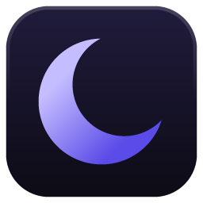
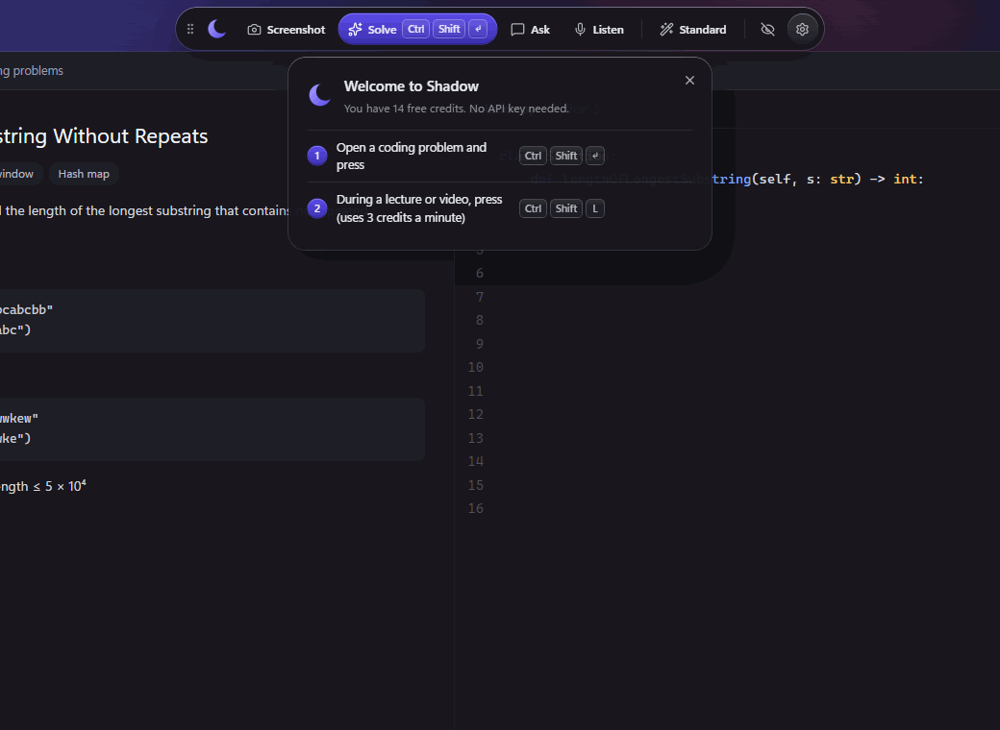
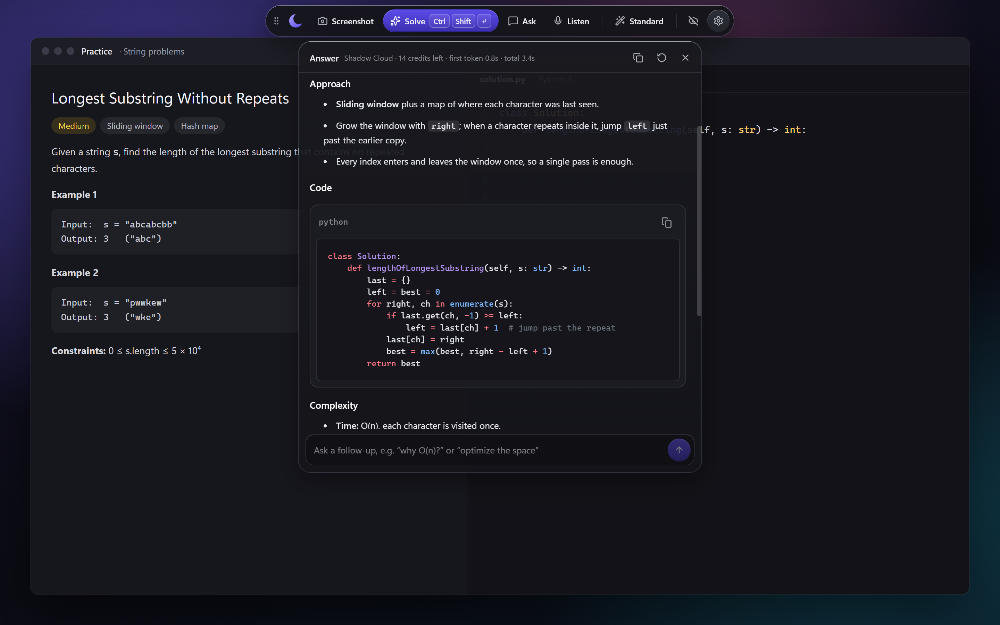
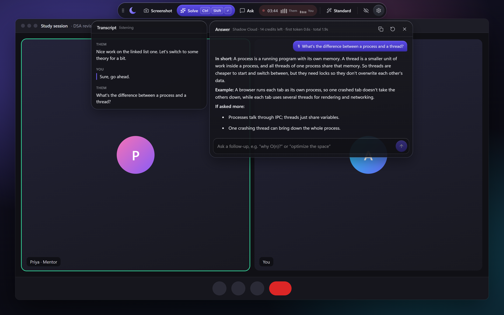
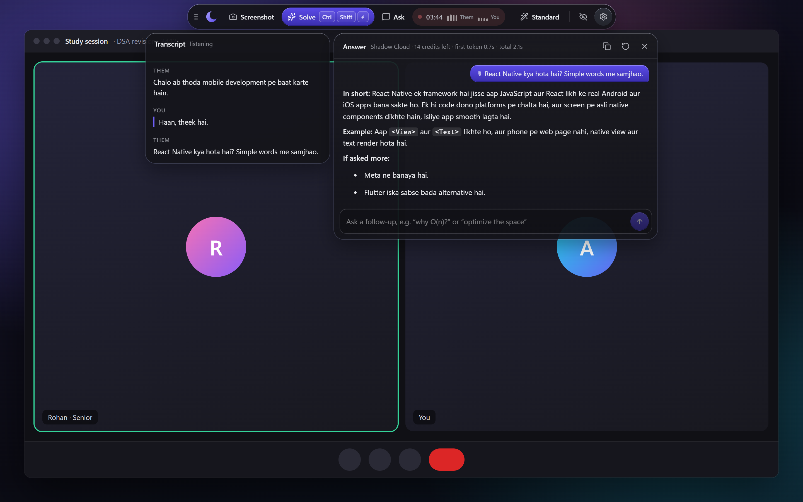
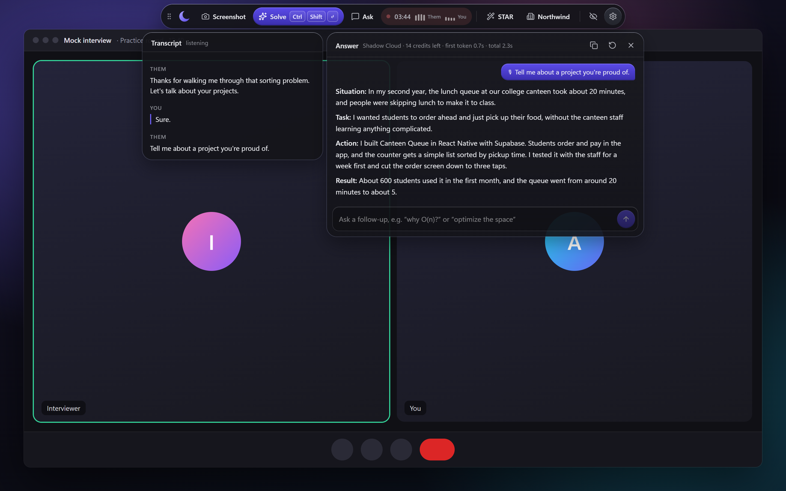
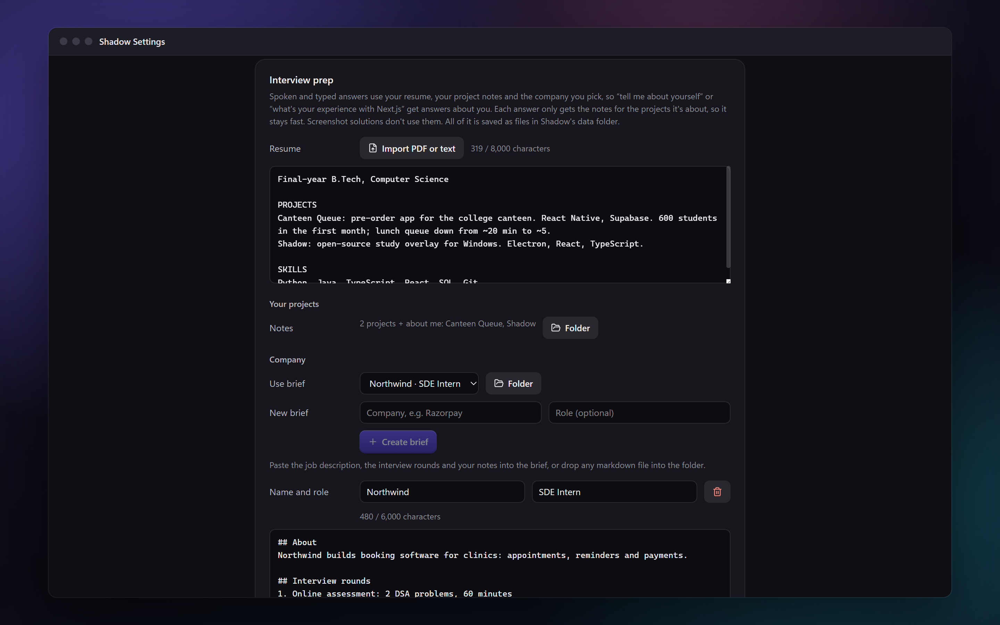
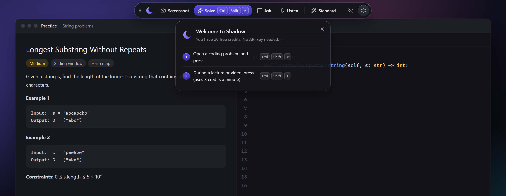
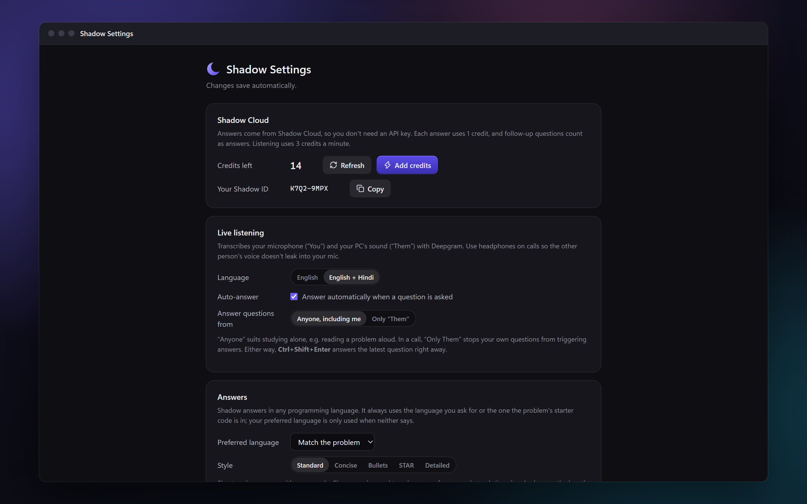

<p align="center">
  
</p>

<h1 align="center">Shadow</h1>

<p align="center">
  <b>One hotkey from stuck to understood.</b><br>
  An open-source study companion for Windows, built as a college project.<br>
  It explains the coding problem on your screen step by step, in any programming language,<br>
  and can transcribe a lecture or a practice video to explain the answer.
</p>

<p align="center">
  
  
  
  <a href="LICENSE"></a>
</p>

<p align="center">
  <sub>Windows installer coming soon · 20 free answers · No account · No API key · <a href="#-getting-started">Get started</a> · <a href="#-what-it-does">Features</a> · <a href="docs/ARCHITECTURE.md">How it works</a></sub>
</p>

<p align="center">
  
</p>

## 💡 Why Shadow

I'm a computer science student in India. When I practise coding problems, the hard part is usually understanding *why* a solution works, not finding one. AI tools that can read your screen and explain it exist, but at **$20 to $299 a month** they cost more than most students spend in a month.

Shadow does that job for a lot less. Install it and you get 20 answers free, with no account and no API key. After that, credits come in one-time packs from ₹49, paid with UPI, and nothing renews. I built it as my college project and kept it open source so anyone can read it or learn from it.

<table>
  <tr>
    <td width="33%" valign="top">
      <h3>💸 Student-priced</h3>
      20 free answers to start, then ₹99 for about 120 more. Pay once, no subscription, no autopay.
    </td>
    <td width="33%" valign="top">
      <h3>🧠 Explains, not just answers</h3>
      Every solution comes with the idea behind it, the time and space complexity, edge cases and a dry run.
    </td>
    <td width="33%" valign="top">
      <h3>🔑 No API key</h3>
      Shadow Cloud runs the AI for you: Gemini writes the answers, and a backup model races it whenever it's slow.
    </td>
  </tr>
</table>

## ✨ What it does

### 📷 Solve what's on your screen

Open any coding problem and press <kbd>Ctrl</kbd> <kbd>Shift</kbd> <kbd>Enter</kbd>. Shadow takes a screenshot, works out the problem, and streams back a solution you can run straight away, explained step by step. It keeps the exact function signature the problem gives you.

<p align="center"></p>

### 🎙️ Transcribe a lecture or a practice video

Press <kbd>Ctrl</kbd> <kbd>Shift</kbd> <kbd>L</kbd> while a lecture, a study call or a mock-interview practice video plays. Shadow transcribes it, picks out the questions that are asked, and explains each answer in a couple of sentences, with code when it's a coding question.

<p align="center"></p>

### 🇮🇳 Hindi and Hinglish too

Ask a question out loud in Hindi or Hinglish and the answer comes back in Hinglish, written in English letters the way you'd say it. Code and technical terms stay in English, and English questions always get English answers.

<p align="center"></p>

### 🎯 Practise for interviews

Add your resume, a few notes on your projects and a brief for the company you're preparing for. In a mock interview, "tell me about yourself" or "tell me about a project you're proud of" gets an answer built from your real projects, in your own words, never invented. Pick an answer style (Standard, Concise, Bullets, STAR or Detailed) from the bar.

<p align="center"></p>

Everything lives in Settings as plain files on your PC: the resume (import a PDF or paste it), one note per project, and one markdown brief per company with the job description, the rounds and your prepared answers.

<p align="center"></p>

### 🛠️ Debug and follow up

- **Debug:** got a wrong answer or an error? Screenshot it and press <kbd>Ctrl</kbd> <kbd>Shift</kbd> <kbd>D</kbd>. Shadow explains what went wrong and gives back fixed code with the changed lines marked.
- **Follow up:** ask "why is this O(n)?", "can you do it in O(1) space?" or "show me this in Java". It remembers the problem.
- **Copy:** <kbd>Ctrl</kbd> <kbd>Shift</kbd> <kbd>C</kbd> copies the solution, ready to paste.

## 🚀 Getting started

> **The Windows installer is coming soon.** Until then you can build Shadow yourself: see *Build from source* below.

1. Install Shadow and run it.
2. Shadow appears as a slim bar at the top of your screen with **20 free credits**. No sign-up, no key.
3. Open any coding problem and press <kbd>Ctrl</kbd> <kbd>Shift</kbd> <kbd>Enter</kbd>.
4. *Optional:* press <kbd>Ctrl</kbd> <kbd>Shift</kbd> <kbd>L</kbd> during a lecture or a practice video to transcribe it and explain the questions asked.

<p align="center"></p>

## ⌨️ Shortcuts

| Do this | Press |
|---|---|
| Explain the problem on screen (or the last question while transcribing) | <kbd>Ctrl</kbd> <kbd>Shift</kbd> <kbd>Enter</kbd> |
| Take a screenshot (up to 4, for long problems) | <kbd>Ctrl</kbd> <kbd>Shift</kbd> <kbd>S</kbd> |
| Start / stop transcribing | <kbd>Ctrl</kbd> <kbd>Shift</kbd> <kbd>L</kbd> |
| Debug with new screenshots | <kbd>Ctrl</kbd> <kbd>Shift</kbd> <kbd>D</kbd> |
| Copy the code | <kbd>Ctrl</kbd> <kbd>Shift</kbd> <kbd>C</kbd> |
| Show / hide Shadow | <kbd>Ctrl</kbd> <kbd>Shift</kbd> <kbd>Space</kbd> |
| New session | <kbd>Ctrl</kbd> <kbd>Shift</kbd> <kbd>R</kbd> |
| Move the bar (or drag its ⠿ handle) | <kbd>Ctrl</kbd> <kbd>Alt</kbd> <kbd>←</kbd><kbd>↑</kbd><kbd>↓</kbd><kbd>→</kbd> |

## 💳 Credits

| | Credits | Price |
|---|---|---|
| Starter (once per PC) | 20 | Free |
| Small | 50 | ₹49 |
| **Regular** | **120** | **₹99** |
| Big | 350 | ₹249 |

- **1 credit = 1 answer.** A follow-up question is an answer too. If the backup model or the screenshot reader joins in, you're still charged once.
- **Listen uses 3 credits a minute**, so ₹99 is about 40 minutes of a lecture.
- **Pay once.** Packs are paid through Razorpay with UPI or a card, prices include GST, and nothing renews. When you run out mid-question, the question is saved and answered as soon as the payment goes through.

More about how it works, with screenshots of every step: **[Shadow Cloud](docs/SHADOW-CLOUD.md)**.

<p align="center"></p>

## 🔒 Privacy

- **No account.** Shadow Cloud knows your install by a random Shadow ID (like `K7Q2-9MPX`), not by your name or email.
- **Your questions aren't stored.** Screenshots, audio and answers pass through Shadow Cloud to the AI provider (Google Gemini or Groq; Deepgram for Listen) and aren't saved on the server. The server keeps your credit balance, payments, and per-answer counts (tokens, cost, speed) so it can bill and keep costs down. To limit free credits, it also counts new installs per network address each day.
- **Your resume and notes stay on your PC.** Only the parts that matter for a question are sent with it.

## 🧩 How it's built## 🧩 How it's built

Electron, React and TypeScript, with the Vercel AI SDK for the AI calls and Deepgram for live transcription. Shadow Cloud is a Cloudflare Worker with a D1 database that holds the AI keys, counts credits and takes payments through Razorpay ([`server/`](server/)).

- **[How Shadow works](docs/ARCHITECTURE.md)**: the design, the security model and the transcription pipeline
- **[Shadow Cloud](docs/SHADOW-CLOUD.md)**: credits, the paywall and the server
- **[Research notes](research/)**: how existing screen-reading AI tools are built, 11 open-source projects compared, and the reasoning behind each design decision

<details>
<summary><b>Build from source</b></summary>

You need Windows 10 or 11 and [Node.js 22+](https://nodejs.org).

```bash
git clone https://github.com/aayush-t-exe/Shadow.git
cd Shadow
npm install
npm run dev        # run with hot reload
npm test           # unit tests
npm run dist       # build dist/Shadow-Setup.exe (Shadow Cloud only)
npm run showcase   # re-render the README screenshots
```

A build from `npm run dev` or `npm run dist:owner` can also use your own API keys instead of Shadow Cloud: Gemini, Groq, OpenRouter, OpenAI, Claude, Ollama on your own PC, or any OpenAI-compatible server. To run Shadow Cloud yourself, see [`server/README.md`](server/README.md).

</details>

## 🗺️ Roadmap

- [x] Solve, debug and follow up from screenshots
- [x] Live transcription with short explanations
- [x] Hindi and Hinglish
- [x] Interview practice from your resume, projects and company briefs
- [x] Shadow Cloud: no API key, one-time credit packs
- [ ] Save sessions and export them as notes
- [ ] Free offline transcription (local Whisper)
- [ ] Custom shortcuts
- [ ] macOS support

## 📄 License

[MIT](LICENSE). Built by [Aayush Thakur](https://github.com/aayush-t-exe) as a college project. If it helped you, a ⭐ means a lot.
