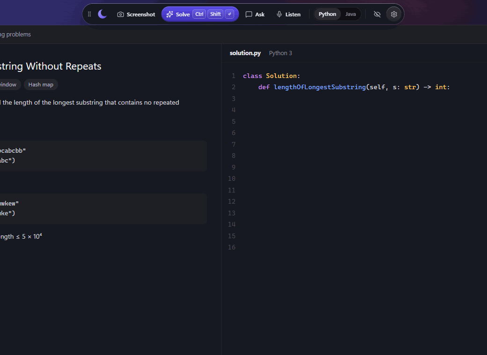
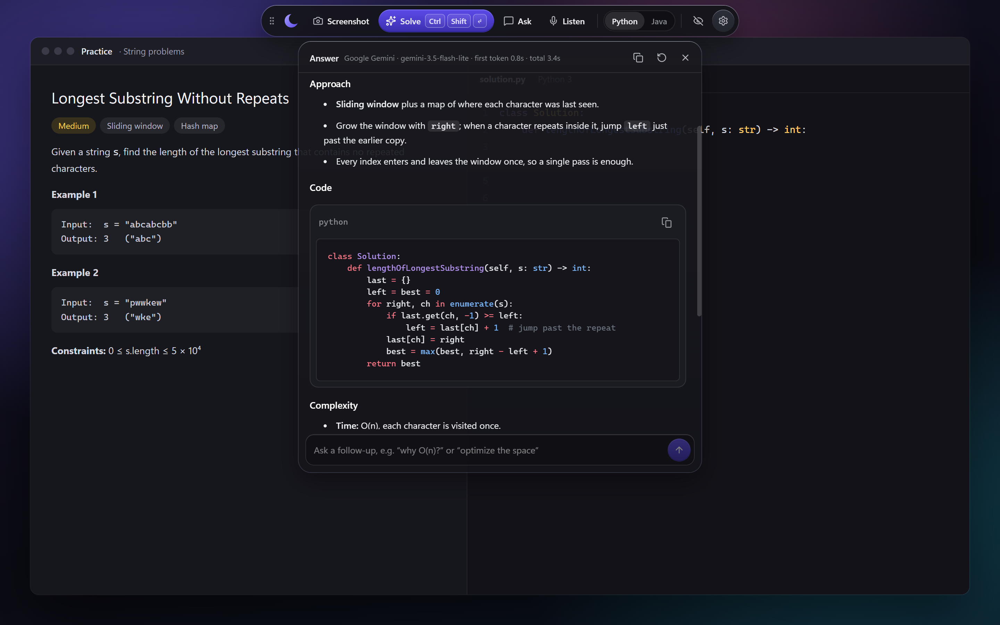
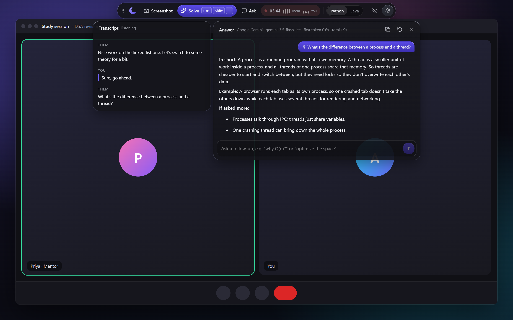
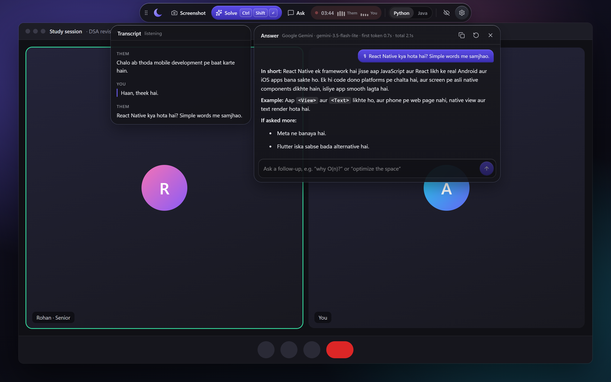
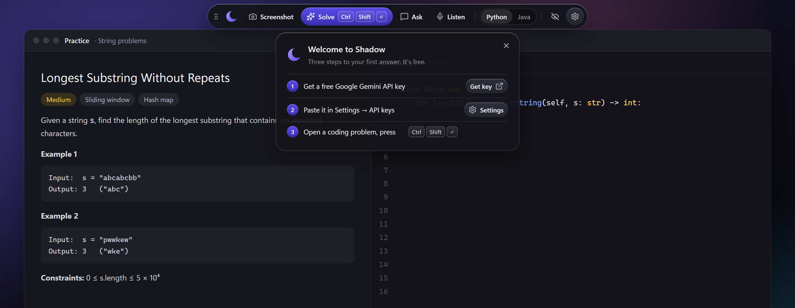
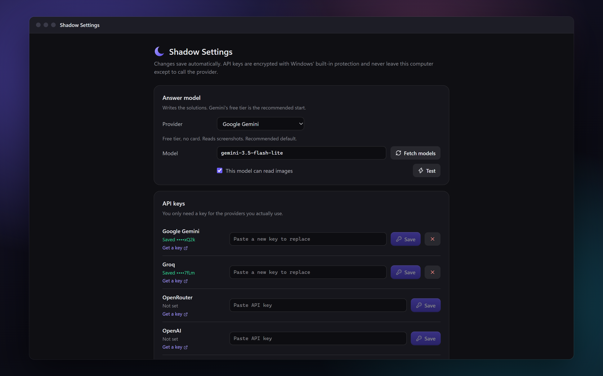

<p align="center">
  
</p>

<h1 align="center">Shadow</h1>

<p align="center">
  <b>One hotkey from stuck to understood.</b><br>
  A free, open-source AI copilot for Windows. It reads the coding problem on your screen,<br>
  listens to the question being asked, and explains the answer in Python or Java.
</p>

<p align="center">
  <a href="https://github.com/aayush-t-exe/shadow/releases/latest"></a>
  
  
  
  <a href="LICENSE"></a>
  <a href="https://github.com/aayush-t-exe/shadow/stargazers"></a>
</p>

<p align="center">
  <a href="https://github.com/aayush-t-exe/shadow/releases/latest/download/Shadow-Setup.exe">
    
  </a>
  <br>
  <sub>Free · No account · Bring a free Gemini key · <a href="#-get-started-in-2-minutes">Get started</a> · <a href="#-what-it-does">Features</a> · <a href="docs/ARCHITECTURE.md">How it works</a></sub>
</p>

<p align="center">
  
</p>

## 💡 Why Shadow

I'm a computer science student in India. Tools like Cluely and Interview Coder can look at your screen and explain what's on it, but at **$20 to $299 a month** they cost more than most students spend in a month.

Shadow does the core of the same job for free. You bring a free API key (Gemini's free tier is plenty for studying), and everything else runs on your own PC. I built it as my college project and kept it open source so anyone can use it, read it, or learn from it.

<table>
  <tr>
    <td width="33%" valign="top">
      <h3>💸 Actually free</h3>
      No subscription, no account, MIT licensed. Works on free-tier keys, or fully offline with a local model.
    </td>
    <td width="33%" valign="top">
      <h3>🧠 Explains, not just answers</h3>
      Every solution comes with the idea behind it, the time and space complexity, edge cases and a dry run.
    </td>
    <td width="33%" valign="top">
      <h3>🔌 Your choice of AI</h3>
      Gemini, Groq, OpenRouter, OpenAI, Claude, Ollama on your own PC, or any OpenAI-compatible server.
    </td>
  </tr>
</table>

## ✨ What it does

### 📷 Solve what's on your screen

Open any coding problem and press <kbd>Ctrl</kbd> <kbd>Shift</kbd> <kbd>Enter</kbd>. Shadow takes a screenshot, works out the problem, and streams back a solution you can run straight away, explained step by step. It keeps the exact function signature the problem gives you.

<p align="center"></p>

### 🎙️ Listen and answer as questions come up

Press <kbd>Ctrl</kbd> <kbd>Shift</kbd> <kbd>L</kbd> during a lecture, a study call or a video. Shadow transcribes both sides of the conversation, notices when a question has been asked, and answers it in a couple of sentences you can take in at a glance, with code when it's a coding question.

<p align="center"></p>

### 🇮🇳 Hindi and Hinglish too

Ask in Hindi and the answer comes back in Hindi; ask in Hinglish and it answers in Hinglish. Code and technical terms stay in English.

<p align="center"></p>

### 🛠️ Debug and follow up

- **Debug:** got a wrong answer or an error? Screenshot it and press <kbd>Ctrl</kbd> <kbd>Shift</kbd> <kbd>D</kbd>. Shadow explains what went wrong and gives back fixed code with the changed lines marked.
- **Follow up:** ask "why is this O(n)?", "can you do it in O(1) space?" or "show me this in Java". It remembers the problem.
- **Copy:** <kbd>Ctrl</kbd> <kbd>Shift</kbd> <kbd>C</kbd> copies the solution, ready to paste.

## 🚀 Get started in 2 minutes

1. **[Download `Shadow-Setup.exe`](https://github.com/aayush-t-exe/shadow/releases/latest/download/Shadow-Setup.exe)** and run it. Windows may say *"Windows protected your PC"*, because the app isn't code-signed (signing certificates cost money). Click **More info → Run anyway**.
2. Shadow appears as a slim bar at the top of your screen. Get a free key at **[aistudio.google.com/apikey](https://aistudio.google.com/apikey)**, click **⚙** in Shadow's bar, and paste it under **API keys**.
3. Open any coding problem and press <kbd>Ctrl</kbd> <kbd>Shift</kbd> <kbd>Enter</kbd>.
4. *Optional:* to use Listen, add a free **[Deepgram](https://console.deepgram.com/signup)** key too ($200 of free credit, no card).

<p align="center"></p>

## ⌨️ Shortcuts

| Do this | Press |
|---|---|
| Solve the problem on screen (or answer the last question while listening) | <kbd>Ctrl</kbd> <kbd>Shift</kbd> <kbd>Enter</kbd> |
| Take a screenshot (up to 4, for long problems) | <kbd>Ctrl</kbd> <kbd>Shift</kbd> <kbd>S</kbd> |
| Start / stop listening | <kbd>Ctrl</kbd> <kbd>Shift</kbd> <kbd>L</kbd> |
| Debug with new screenshots | <kbd>Ctrl</kbd> <kbd>Shift</kbd> <kbd>D</kbd> |
| Copy the code | <kbd>Ctrl</kbd> <kbd>Shift</kbd> <kbd>C</kbd> |
| Show / hide Shadow | <kbd>Ctrl</kbd> <kbd>Shift</kbd> <kbd>Space</kbd> |
| New session | <kbd>Ctrl</kbd> <kbd>Shift</kbd> <kbd>R</kbd> |
| Move the bar (or drag its ⠿ handle) | <kbd>Ctrl</kbd> <kbd>Alt</kbd> <kbd>←</kbd><kbd>↑</kbd><kbd>↓</kbd><kbd>→</kbd> |

## 🔌 Bring your own AI

| Provider | Cost | Good for |
|---|---|---|
| **Google Gemini** (default) | Free tier, no card | Reading screenshots, fast answers |
| **Groq** | Free tier | Very fast answers |
| **OpenRouter** | Free models available | Trying many different models with one key |
| **OpenAI** / **Anthropic Claude** | Paid | The strongest reasoning |
| **Ollama** | Free, runs on your PC | Working offline and fully private |
| **Any OpenAI-compatible server** | Depends | LM Studio, DeepSeek, vLLM and others |

Pick a provider in Settings, click **Fetch models** to see what your key can use, and **Test** to check it works. Answers show which model replied and how fast.

<p align="center"></p>

## 🔒 Privacy

- **Your keys stay on your PC**, encrypted with Windows' built-in protection. Shadow never shows them again after you save them.
- **Screenshots and audio go only to the provider you picked.** Shadow has no server of its own and collects nothing.
- **Shadow is visible on purpose.** It doesn't hide from screen sharing, recording or proctoring software. It's a study tool, not a way to get help without others knowing.

## 🧩 How it's built

Electron, React and TypeScript, with the Vercel AI SDK talking to seven providers and Deepgram for live transcription. Every AI call runs in Electron's background process, so the interface never sees your keys.

- **[How Shadow works](docs/ARCHITECTURE.md)**: the design, the security model and the live-listening pipeline
- **[Research notes](research/)**: how Cluely and Interview Coder work, 11 open-source alternatives compared, and the reasoning behind each design decision

<details>
<summary><b>Build from source</b></summary>

You need Windows 10 or 11 and [Node.js 22+](https://nodejs.org).

```bash
git clone https://github.com/aayush-t-exe/shadow.git
cd shadow
npm install
npm run dev        # run with hot reload
npm test           # unit tests
npm run dist       # build dist/Shadow-Setup.exe
npm run showcase   # re-render the README screenshots
```

</details>

## 🗺️ Roadmap

- [x] Solve, debug and follow up from screenshots
- [x] Live listening with automatic answers
- [x] Seven AI providers, including fully local
- [x] Hindi and Hinglish
- [ ] Save sessions and export them as notes
- [ ] Free offline transcription (local Whisper)
- [ ] Custom shortcuts
- [ ] macOS support

## 📄 License

[MIT](LICENSE). Built by [Aayush Thakur](https://github.com/aayush-t-exe) as a college project. If it helped you, a ⭐ means a lot.
