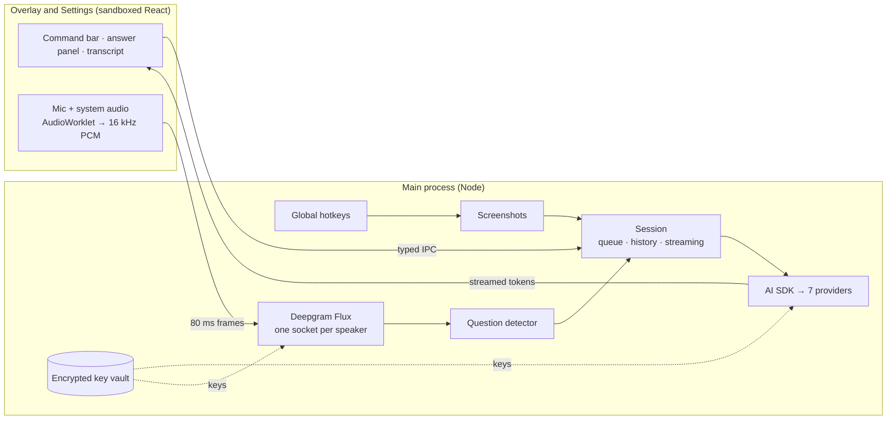
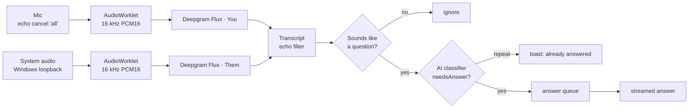

# How Shadow works

This page is for people who want to know what's under the hood: the design, the security model,
and how live listening decides when to answer. For what Shadow does, see the [README](../README.md).
The research behind these decisions is in [`research/`](../research/).

## The big picture



Shadow is an Electron app with two kinds of process:

- **The renderer** draws the overlay and the Settings window. It's sandboxed: no Node.js, no network access, and a strict Content Security Policy. It owns the microphone, because only a web page can call `getUserMedia`.
- **The main process** does everything that needs privileges: global hotkeys, screenshots, every AI and speech-to-text call, and the key vault.

They talk over a typed IPC bridge. Every channel name lives in one file (`src/shared/api.ts`), so the two sides can't drift apart.

## Security model

A 2025 security write-up showed that a link inside one commercial overlay's AI answer could quietly take screenshots and record audio, because its renderer could call anything in the main process. Shadow is built so that can't happen:

| Measure | What it prevents |
|---|---|
| `sandbox: true`, `contextIsolation: true`, no `nodeIntegration` | Page code, including anything in an AI answer, can't touch the file system or Node.js |
| A preload bridge that exposes named functions only, never raw `ipcRenderer` | The page can't send arbitrary messages to main |
| Every IPC handler checks that the sender is Shadow's own page, and validates arguments with zod | Injected frames or malformed input get nothing |
| Navigation and pop-ups blocked; `https` links open in the real browser | An answer can't load a malicious page inside Shadow |
| Microphone and screen capture allowed only for Shadow's own pages; every other browser permission denied | No silent capture by anything else |
| Keys encrypted with Windows DPAPI (`safeStorage`); the renderer only ever learns "saved ••••abcd" | Keys never reach the interface or logs |
| Error messages scrubbed of anything that looks like a key | Keys can't leak into the UI by accident |

DPAPI protects keys from other Windows users and from copying the config file to another machine. Like a browser's saved passwords, it doesn't protect against other programs running as the same user.

**Shadow deliberately doesn't hide itself** from screen sharing or recording. It's a visible study tool.

## Solving from screenshots

1. The hotkey captures the monitor under the mouse at full physical resolution, correcting for Windows display scaling. Shadow hides itself for about 160 ms so it isn't in its own screenshot.
2. Up to four screenshots queue up, for problems that need scrolling.
3. The prompt is built from small blocks: base instructions, Python or Java rules, and length. It asks for fixed `##` sections (Problem, Approach, Code, Complexity, Edge Cases, Dry Run) instead of JSON, because markdown streams cleanly and even small local models follow it.
4. If the chosen model can't read images, a vision model first turns the screenshots into text (a two-stage pipeline).
5. Tokens stream through the [Vercel AI SDK](https://ai-sdk.dev) and are batched every 30 ms before crossing IPC, then rendered by [Streamdown](https://github.com/vercel/streamdown) with Shiki highlighting, which repairs half-finished markdown mid-stream.
6. History is kept text-only, so follow-ups don't re-upload screenshots and waste free-tier quota.

## Live listening



- **Two separate streams.** The mic is "You" and Windows' system-audio loopback is "Them" (whatever a call or video plays). Each gets its own 16 kHz `AudioContext`, so Chromium does the resampling and the voices never mix.
- **Turn detection.** [Deepgram Flux](https://developers.deepgram.com/docs/flux/quickstart) reports when someone has *finished* a turn, not just paused. Stopping sends `ForceEndTurn` before closing, so the last sentence is never lost.
- **Echo filter.** If the call plays through speakers, your mic hears it too. A "You" line that closely matches a recent "Them" line is dropped.
- **Deciding when to answer**, cheapest check first:
  1. A free heuristic (question words, "?", problem statements, Hindi and Hinglish question words) filters out small talk.
  2. If "You" starts talking right after "Them", you're answering yourself, so Shadow stays quiet.
  3. A small AI classifier returns JSON: `{needsAnswer, alreadyAnswered, question, confidence}`. It rewrites fragmented, misheard speech into one clean question ("binary error" → "binary array").
  4. Questions queue behind an answer that's still streaming instead of cutting it off.
- **Pressing the hotkey** answers the latest question and joins the speaker's back-to-back turns, because people read problems out in several breaths.
- **Answers are short and spoken-style** (an "In short" summary plus one example) and come back in the language of the question.

## Click-through overlay

The overlay is a single transparent, always-on-top window, and most of it is empty. The renderer reports where its visible controls are, and main checks the real cursor position 25 times a second, capturing the mouse only over those controls. Clicks anywhere else go to the app underneath. This replaced an approach based on forwarded mouse events, which flickered on Windows.

## Testing

- `npm test` runs the unit tests (Vitest). They cover the prompt builders, question detection (including real Deepgram transcripts with their mishearings, and Hindi), echo similarity, joining multi-part questions, code-block extraction mid-stream, and cursor hit-testing.
- `npm run typecheck` runs strict TypeScript for both processes.
- `npm run showcase` renders the README screenshots and the demo GIF from the real React components with sample data, in a hidden window (`src/renderer/src/showcase`, `scripts/showcase`).

## Project layout

```
src/
  main/        hotkeys, windows, screenshots, session, settings, key vault, IPC
    ai/        providers, prompts, error mapping
    live/      audio permissions, Deepgram client, listening, auto-answer
  preload/     the typed bridge between page and main
  renderer/    overlay and settings UI (React), audio worklet, screenshot studio
  shared/      types and pure logic shared by both sides (and unit-tested)
scripts/       dev launcher, icon generator, screenshot studio runner
research/      the research the design is based on
```
