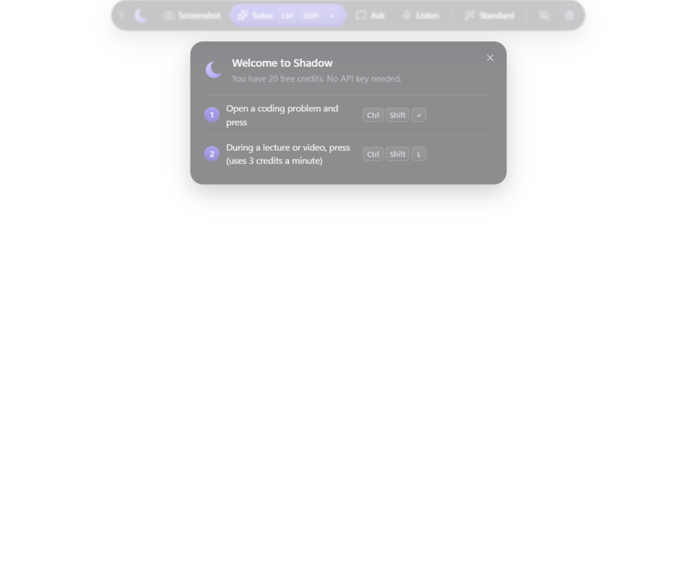
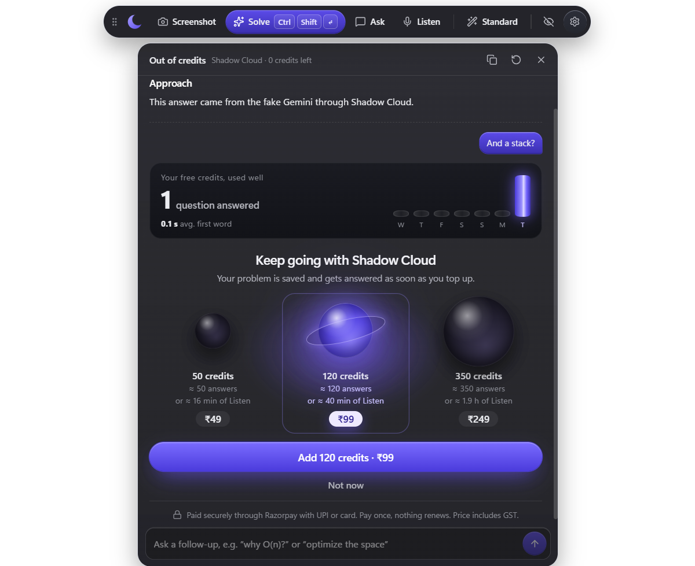
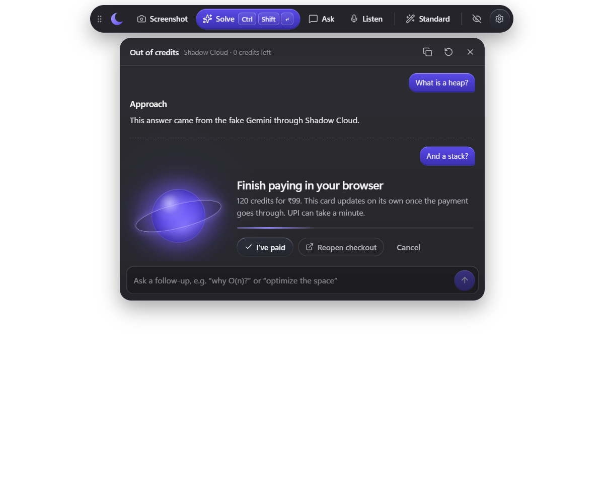
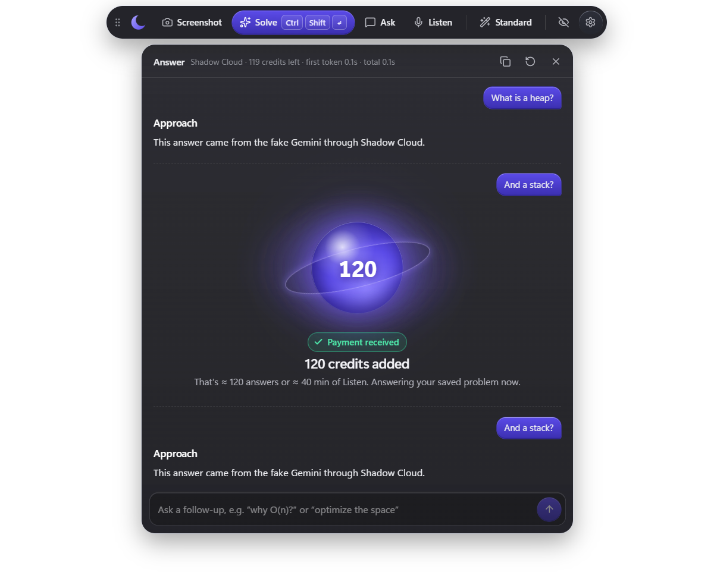
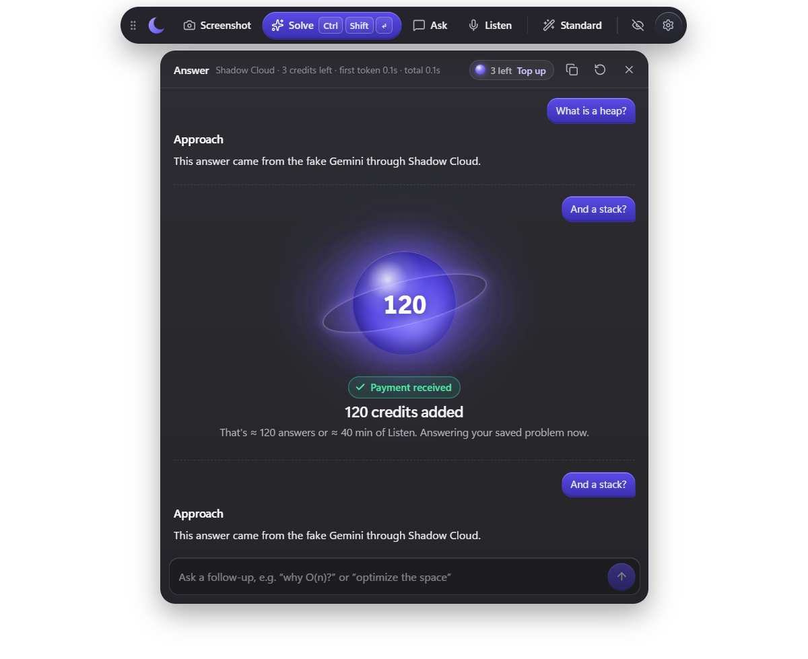
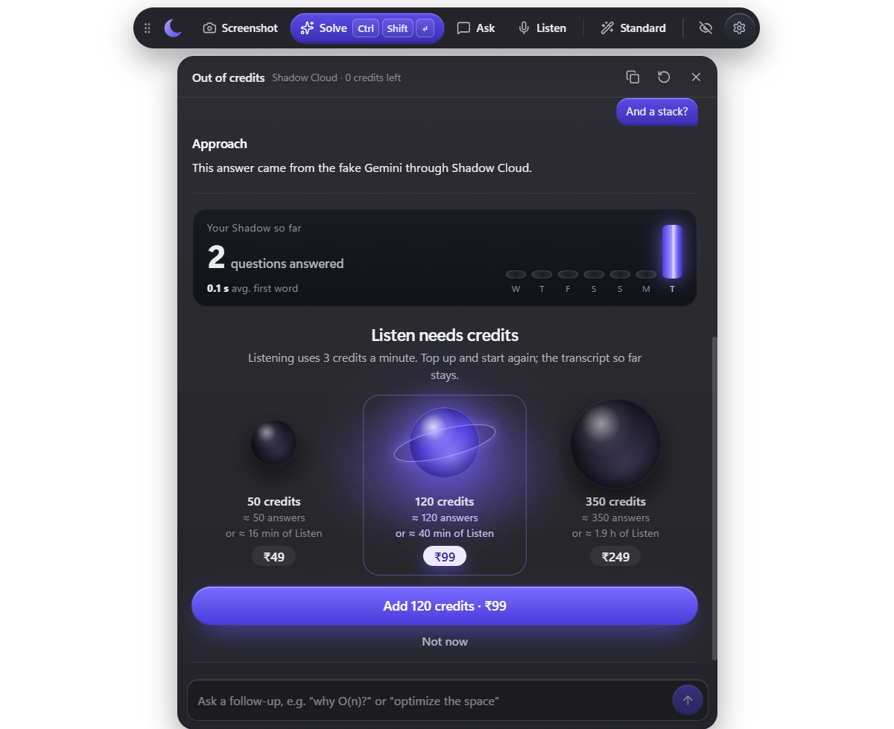
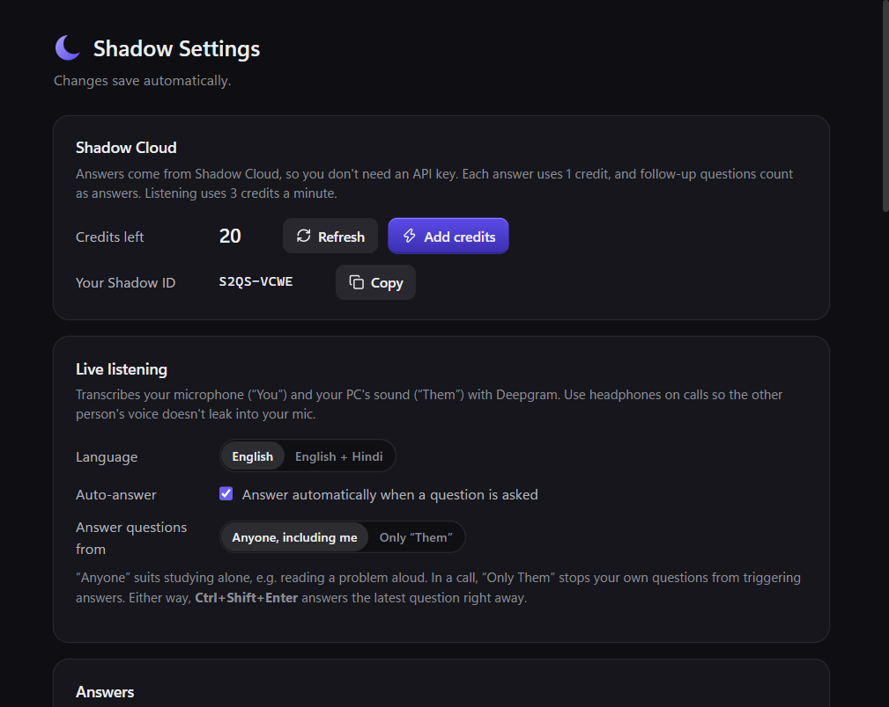

# Shadow Cloud

Shadow Cloud lets people use Shadow without getting an API key. A small server
([`server/`](../server/)) holds the AI keys, gives every new install free starter credits, and sells
more as one-time credit packs. Nothing renews.

- **1 credit = 1 answer.** Follow-ups count as answers; the backup model and the screenshot reader
  never charge twice for the same answer.
- **Listen uses 3 credits a minute.** The audio goes straight to Deepgram with a 1-minute token from
  the server.
- **The public installer only uses Shadow Cloud.** A build made with `npm run dev` or
  `npm run dist:owner` also keeps "use my own API keys" ([`src/shared/edition.ts`](../src/shared/edition.ts)).

How to run, test and deploy the server: [`server/README.md`](../server/README.md).

## What it looks like

The screenshots below are the real app, taken by the end-to-end test (`server/scripts/app-e2e.mjs`)
against a local Shadow Cloud with fake AI providers. That's why the sample answers say "fake Gemini".

**First launch: no key, no sign-up.**

**Out of credits.** The paywall takes the answer's place and the question is saved. It shows what the
free credits already did, then three packs, each with what it buys in answers and in Listen minutes.

**Paying.** The payment page opens in the browser; this card updates on its own.

**Payment received.** The orb lights up and counts to the new credits (about 4 seconds, once per
payment, with a plain fade for reduced motion). Then the saved question is answered.

**Running low.** A small chip in the header; nothing pops up.

**Listen without credits** opens the same paywall instead of an error.

**Settings** shows credits left, the Shadow ID (for support), and Add credits.

